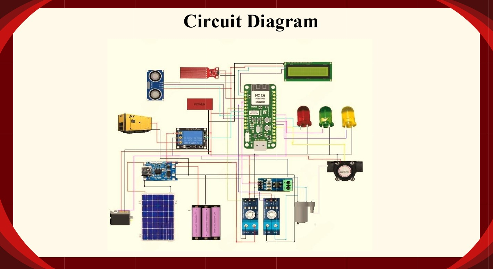

# Smart Solar-Diesel Hybrid Dewatering System for Copper Mines (TerraVolts)

**Built by Team Terra World Dynamics** | **Team Lead:** Sathyajith G  
**Event:** Larsen & Toubro — **SMARTATHON 2.0** *(IEEE Madras Section · IEEE Industry Applications Society · St. Joseph's College Student Branch Chapter)*  
**Domain:** Smart Energy & Sustainable Infrastructure  

---

## 1. Problem Statement & Abstract
Continuous groundwater accumulation in underground copper mines requires reliable, uninterrupted dewatering to keep shafts safe and operational:
* **High Cost & Emissions of Diesel:** Relying solely on diesel-powered pumps incurs heavy fuel expenses and underground exhaust pollution.
* **Solar Intermittency:** Standalone solar pumping cannot guarantee continuous operation during cloudy periods or night shifts.
* **Our Solution (TerraVolts):** An intelligent ESP32-C6 hybrid energy management and dewatering controller that prioritizes clean solar power with automatic LDR sun-tracking, seamlessly transfers load to a backup diesel generator when solar voltage drops below threshold, tracks flow volume for operational billing, and provides instant remote emergency shutdown via a companion Android app.

---

## 2. Detailed Solution & Key Innovations
* **Automated Sump Water-Level Control:** Continuous water-level sensing with digital hysteresis (`WATER_WET_VAL` / `WATER_DRY_VAL` and dry-confirmation timers) automatically starts dewatering when excess water accumulates and stops pumping once drained.
* **Hybrid Solar-to-Diesel Automatic Failover:** Oversampled ADC voltage sensing monitors solar generation in real time. When solar voltage falls below `2.0 V`, the controller immediately engages the backup diesel relay; once solar recovers above `2.5 V` for 2 seconds, it smoothly switches back to solar power.
* **Sunflower-Style Solar Tracking:** Dual LDR sensors (`LDR1` & `LDR2`) drive an `SG90` servo using proportional step control and deadband filtering to keep the solar panel aligned with peak irradiance.
* **Flow-Based Monitoring & Billing (`YF-S201`):** Interrupt-driven Hall-effect flow meter calculates live discharge rate (`L/min`) and cumulative water volume pumped (`Liters`) for energy/water billing and pump efficiency tracking.
* **Local Alerts & Firebase IoT Dashboard:**
  * Rotating 16x2 I2C LCD screens display water presence, motor state, active supply (`Solar` / `Diesel`), solar voltage, and low-voltage warnings alongside Green/Red status LEDs and buzzer alerts.
  * Syncs live telemetry to Firebase Realtime Database every 5 seconds (`/pumpSystem/liveData`), logs timestamped history every 5 minutes (`/pumpSystem/history`), and executes instant **Remote Emergency Shutdown** commands from the Android app (`/pumpSystem/control/shutdown`).

---

## 3. Circuit Diagram & Hardware Pinout (`PCBCUPID GLYPH-C6`)

| Subsystem / Sensor | ESP32-C6 Pin | Role in System |
| :--- | :--- | :--- |
| **Solar Voltage Sensor** | `GPIO 0` (A0) | 50x oversampled ADC reading of solar panel output |
| **Water Level Sensor** | `GPIO 1` (A1) | Sump water threshold detection with hysteresis |
| **LDR Sensor 1 & 2** | `GPIO 2`, `GPIO 3` | Dual light sensing for sunflower solar tracking |
| **16x2 I2C LCD (`0x27`)** | `GPIO 4` (SDA), `GPIO 5` (SCL) | Local rotating status & low-voltage warning display |
| **YF-S201 Flow Sensor** | `GPIO 6` (D6) | Interrupt pulse counter for `L/min` & cumulative `Liters` |
| **SG90 Tracking Servo** | `GPIO 7` (D7) | Adjusts solar panel angle (`0°–180°`, parks at `90°` on shutdown) |
| **Status LEDs & Buzzer** | `GPIO 8` (Green), `GPIO 9` (Red), `GPIO 14` | Running, shutdown, and audible state-change alerts |
| **Solar & Diesel Relays** | `GPIO 18` (Solar), `GPIO 23` (Diesel) | Debounced power source switching for the dewatering pump |

---

## 4. Feasibility, Viability & Impact
* **Scalable & Retrofit-Ready:** Designed to interface with existing industrial mine dewatering pump contactors at low hardware cost.
* **Reduced Diesel & Carbon Footprint:** Maximizes daytime solar utilization via active sun-tracking, cutting diesel fuel consumption and operating expenses.
* **Improved Mine Safety:** Automated sump drainage, hardware anti-chatter protection, and one-tap app emergency shutdown prevent flooding and equipment damage.

---

## 5. Project Files & Demo
* **Firmware:** [`firmware/terravolts_esp32c6.ino`](firmware/terravolts_esp32c6.ino) — ESP32-C6 Arduino/C++ source code.
* **Android App:** [`app/`](app/) — Companion Android APK for real-time telemetry and remote emergency shutdown.
* **Pitch Deck:** [`Smartathon_2.0_Pitch_Deck.pdf`](Smartathon_2.0_Pitch_Deck.pdf) — Official L&T SMARTATHON 2.0 presentation.
* **Working Prototype Video:** *(Upload your running demo video as Unlisted on YouTube and paste the link here)*
